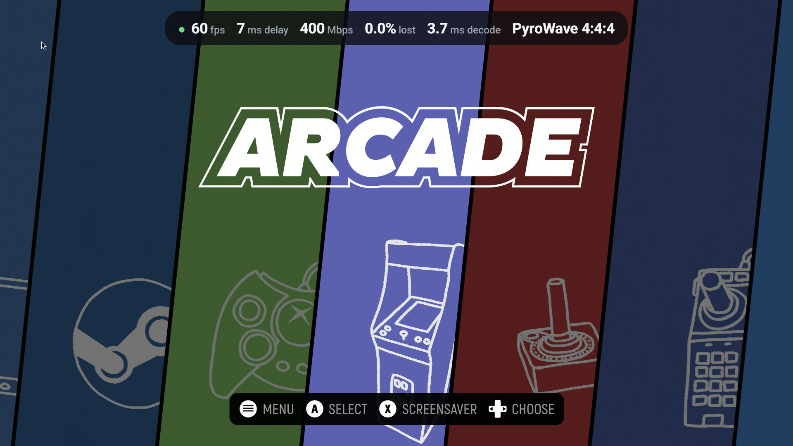
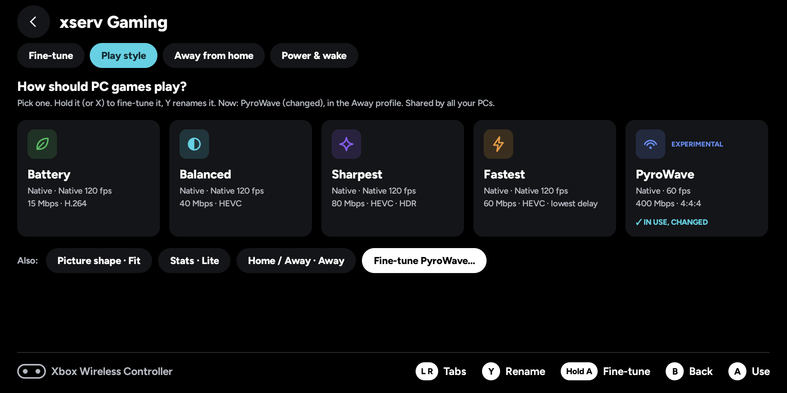
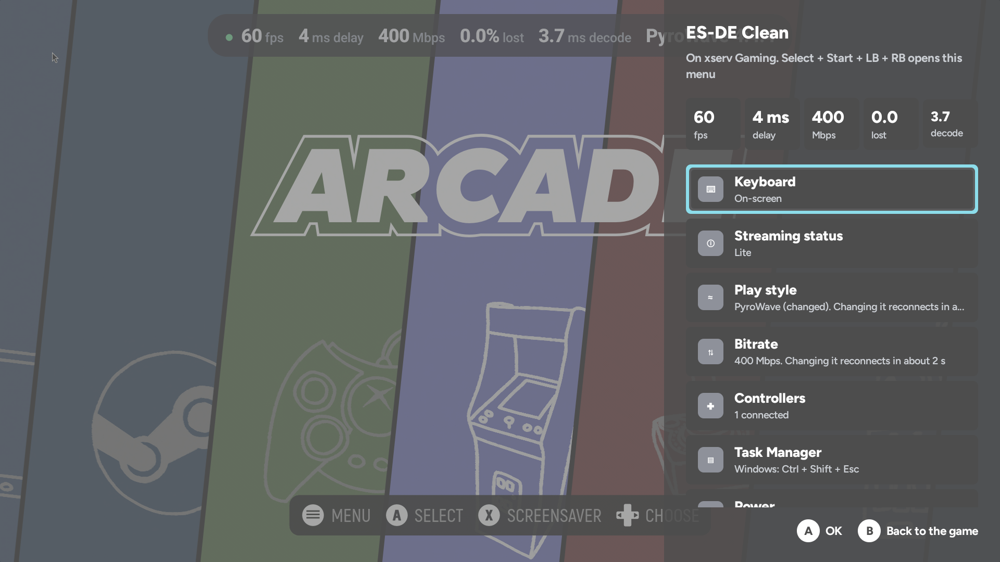
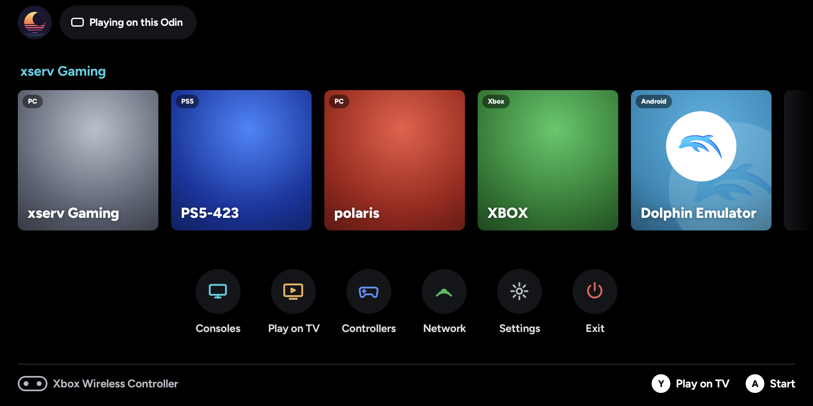

# MoonCast (Português, Brasil)

[English](README.md) · **Português (Brasil)**

Jogue do seu **PC, PS5 e Xbox** no Android, em um handheld ou na TV.

**MoonCast** é um app gratuito e de código aberto para celulares Android, handhelds (Odin, Retroid e outros) e TVs. Ele é feito para ser usado só com o controle, da tela inicial até o menu dentro do jogo.

O MoonCast nasceu do [Moonlight para Android](https://github.com/moonlight-stream/moonlight-android) e mantém o motor de streaming dele. A tela inicial, o suporte aos consoles e a ligação com a TV são do próprio MoonCast.

## Capturas de tela

| | |
|---|---|
|  |  |
|  |  |

Tiradas em um AYN Odin 2 Portal.

## O que ele joga

| | Como | O que você precisa |
|---|---|---|
| **PC** | Pelo protocolo do Moonlight, com [Sunshine](https://github.com/LizardByte/Sunshine) (ou Apollo/Polaris) no PC | Sunshine, com as configurações padrão |
| **PS5** | Remote Play nativo (baseado no [chiaki-ng](https://github.com/streetpea/chiaki-ng)), em casa ou fora de casa pela PlayStation Network, sem VPN | Entrar na PlayStation Network uma vez, para registrar o console |
| **Xbox** | Remote Play nativo da Xbox | Entrar com a conta Microsoft: o app mostra um código e você digita em microsoft.com/link |

## Destaques

- **Uma tela inicial** para PC, PS5 e Xbox, e um **menu dentro do jogo** aberto pelo controle (Select + Start + L1 + R1).
- **Estilos de jogo:** Bateria, Equilibrado, Mais nítido e Mais rápido. Dá para trocar durante o jogo.
- **Enviar para a TV:** o jogo passa para a TV com o MoonCast TV e o handheld vira o controle.
- **Super resolução (FSR)**, imagem em imagem e suporte a dobráveis.
- **PyroWave** (experimental, só PC) e **bitrate automático** (desligado por padrão).
- **Casa e fora de casa:** em casa usa a sua rede; fora, o PS5 funciona pela PlayStation Network.
- **Controles:** pads Bluetooth e USB, tela de teste de botões e controle na tela com layouts de PlayStation e Xbox.

## Como instalar

1. Abra a página de [Releases](https://github.com/MoonCastDev/moonlight-android/releases/latest).
2. Baixe o `MoonCast-….apk` (celular/handheld) ou o `MoonCastTV-….apk` (Android TV/Google TV).
3. Permita a instalação de apps de fora da loja e abra o arquivo. Funciona do Android 5.0 em diante.

**Dica:** com o [Obtainium](https://github.com/ImranR98/Obtainium) você recebe as atualizações automaticamente.

## Privacidade

Sem anúncios e sem conta própria. Existe uma verificação de uso anônima e **opcional** (o app pergunta uma vez): se você aceitar, ela envia uma vez por dia a versão do app, o modelo do aparelho e se você jogou PC, PS5 ou Xbox. Nunca envia nomes, endereços, jogos nem contas. Só os builds oficiais podem enviar; um build que você mesmo compilar nunca pergunta e nunca envia.

## Feedback

É um beta. Conte qual aparelho você usa e o que funcionou ou não, abrindo uma [issue](https://github.com/MoonCastDev/moonlight-android/issues) ou comentando no post do Reddit. Obrigado!

## Créditos e licença

Moonlight, chiaki-ng, PyroWave (Themaister) e Moonlight X. MoonCast é software livre sob a licença GPL-3.0.
